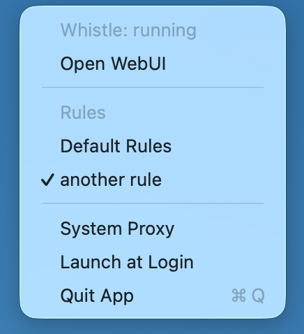

# Whistle Menubar


一个轻量的 macOS 菜单栏工具，用来快速控制本机 [Whistle](https://github.com/avwo/whistle)。

<p align="center">
  
</p>

## 功能

- 查看 Whistle 运行状态，并在停止时快速启动
- 打开 Whistle WebUI
- 查看并切换 Rules
- 开启 / 关闭系统代理
- 开机自动启动

## 安装

需要 macOS 14+、Apple Silicon，以及已安装并配置好的 Whistle。

用 Homebrew 安装后，在「应用程序」中打开 Whistle Menubar：

```sh
brew install --cask viko16/tap/whistle-menubar
```

也可以从 [Releases](https://github.com/viko16/whistle-menubar/releases) 下载 ZIP，解压后将 `whistle-menubar.app` 拖到「应用程序」。应用使用 ad-hoc 签名，首次启动若被 macOS 拦截，可在「系统设置 → 隐私与安全性」中选择「仍要打开」。

## 开发

```bash
./script/test.sh
./script/run_app.sh
./script/package_app.sh
```

应用只与本机 Whistle、`w2` 和 macOS 系统设置交互，**不会连接外部服务或上传数据**。

> Whistle Menubar 是非官方项目，与 Whistle 官方无隶属关系。
